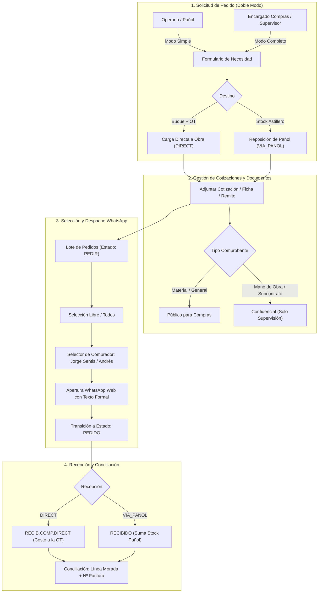
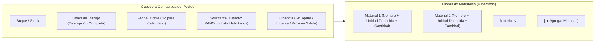

# Módulo 4b: Compras y Proveedores

> **Módulo:** M4b — Compras & Logística de Insumos  
> **Estado:** ✅ Implementado, Ajustado y Operativo  
> **Ruta en App:** `/compras`  
> **Panel de Configuración:** `/admin` (Tab *"Config. Compras & WhatsApp"*)  
> **Referencia Legacy:** Planilla GS-006 (`1k1BBl1pAf8HlGfiNzSt5xGHpkgQw1dD3tWERTYhu3MY`)  
> **Migraciones SQL:** `0024_create_suppliers_and_purchase_orders.sql` y `0025_purchase_orders_enhancements.sql`

---

## 1. Visión General y Flujo Operativo

El **Módulo de Compras (M4b)** digitaliza integralmente la planilla GS-006 del astillero, optimizando el circuito diario de aprovisionamiento de materiales, gases industriales, fijaciones y consumibles navales.



---

## 2. Componentes de UI y Estándares Mandatorios

### 2.1. Inmovilización de Encabezados (Sticky Header tipo Excel)
La cabecera de la tabla permanece congelada en la parte superior (`sticky top-0 z-20 bg-slate-950`) durante todo el desplazamiento vertical de la grilla, permitiendo leer columnas y acceder a los selectores maestros sin perder el contexto.

### 2.2. Doble Modo de Interfaz: Solicitud Simple vs Gestión Completa
- **Modo Solicitud Simple (`viewMode = 'simple'`):** Pensado para personal de pañol, jefes de obra o personal ajeno a compras. Oculta proveedores, costos del sistema, costos cotizados, fechas estimadas de entrega y despachos por WhatsApp. Permite cargar pedidos de materiales de forma ágil sin exponer datos comerciales confidenciales.
- **Modo Gestión Completa (`viewMode = 'completa'`):** Diseñado para el Encargado de Compras y la Gerencia. Despliega todas las columnas analíticas, proveedores, cotizaciones, fechas de entrega, botones de WhatsApp Web y acciones de recepción.

### 2.3. KPIs Superiores como Filtros Interactivos (1 Clic)
Los indicadores superiores de la pestaña de compras y de proveedores funcionan como botones conmutables de filtro reactivo:
- **En Compras:** Total Pedidos, Pendientes de Pedir (`PEDIR`), En Gestión (`PEDIDO` / `COTIZACION`), Recibidos (`RECIBIDO`), Conciliados con Factura (`is_reconciled`), Urgentes (`URGENTE` / `PROXIMA_SALIDA`).
- **En Proveedores:** Total Proveedores, Sin Teléfono, Sin Email, Sin Rubro Asignado, Proveedores de Gases P-02.
Al hacer clic sobre cualquiera de ellos, la tabla filtra inmediatamente el subconjunto de filas correspondiente; al hacer clic nuevamente se desactiva el filtro.

### 2.4. Selección Libre de Filas + Barra Flotante Reactiva de Totales
Ubicada en la base de la pantalla (`fixed bottom-4 left-4 right-4 md:left-64 z-40 bg-slate-950/95`):
- **Modo interactivo dual:**
  - `📌 Selección Manual: N pedidos` (cuando el usuario tilda casillas a su antojo, con botón `✕ Limpiar`).
  - `🌐 Todo el filtro: N pedidos` (muestra métricas globales del conjunto filtrado).
- **Métricas reactivas vivas:**
  - Cantidad total de insumos (`Σ Cant`).
  - Sumatoria total en pesos (`Σ AR$`).
  - Sumatoria total en dólares (`Σ US$` calculada con el tipo de cambio quincenal oficial configurado en `macro_variables`).
  - Promedio de costo unitario (`Ø`).
- **Acciones en lote:**
  - `[ 🛒 Pedir Agrupado (N) ]`: Agrupa los seleccionados por proveedor, solicita elegir al comprador (Jorge Sentis o Andrés) y abre directamente una conversación de WhatsApp Web con el contacto comercial registrado.
  - `[ ✅ Recibir (N) ]`: Marca los ítems como recibidos, derivando a Pañol o Buque según corresponda.

---

## 3. Formulario de Pedido de Compra Multi-Material

El modal `[ ➕ Nuevo Pedido ]` optimiza la carga repetitiva permitiendo imputar múltiples ítems a un mismo destino en un único acto:



### 3.1. Campos y Reglas de la Cabecera
1. **Descripción Completa de la OT:** Al seleccionar una OT, la interfaz despliega en texto destacado la descripción técnica completa del trabajo (`work_items` / `work_orders`), eliminando ambigüedades.
2. **Selector de Fecha con Doble Clic:** Todos los inputs de fecha admiten doble clic para invocar inmediatamente el calendario nativo del navegador (`showPicker()`).
3. **Solicitante Inteligente:** Inicializa por defecto en `"PAÑOL"`. Permite seleccionar directamente a cualquier operario o contratista habilitado para retirar insumos (`can_withdraw_materials = true`) o escribir un solicitante libre.
4. **Casilla de Urgencia:**
   - `SIN_APURO` (Por defecto): Pedido regular programado.
   - `URGENTE`: Requerimiento crítico para destrabar obra en varadero.
   - `PROXIMA_SALIDA`: Insumo necesario antes de que el buque zarpe del astillero.

### 3.2. Regla de Deducción Automática y Forzada de Unidad de Medida
Para evitar que operarios ingresen unidades erróneas (ej. pedir chapa por kg en lugar de m², arruinando el stock futuro), la unidad de medida se infiere de forma estricta y se bloquea contra edición manual en el pedido:

| Patrón en el Nombre del Material | Unidad Asignada Automáticamente |
|---|---|
| Contiene `lado x lado` o `m2` | `m2` (Área) |
| Contiene `x metro lineal`, `x metro`, `x mt` | `metro lineal` |
| Contiene `x kilo`, `x kg` | `kg` |
| Contiene `x m3` o `metro cubico` | `m3` |
| Ninguno de los anteriores | `unidad` (Por defecto) |

> [!NOTE]
> En la futura implementación del módulo de Pañol y alta de nuevos materiales, se dispondrá de una columna editable de unidad de medida con advertencia explícita en caso de que el insumo tenga control de stock activo.

---

## 4. Configuración de Compradores y WhatsApp (Admin)

### 4.1. Panel Centralizado en Administración (`/admin`)
La pestaña **"Config. Compras & WhatsApp"** en el Panel de Administrador (`ComprasSettingsPanel.jsx`) permite configurar los teléfonos de los compradores oficiales del astillero, almacenados en `public.system_settings` (clave `compras_whatsapp`):
- **Comprador 1:** Jorge Sentis (Nombre, Celular, Estado Activo).
- **Comprador 2:** Andrés (Nombre, Celular, Estado Activo).
- **Saludo Formal Predeterminado:** Texto inicial de presentación ante los proveedores.

> [!IMPORTANT]
> Estos números de WhatsApp de compradores son líneas personales/comerciales directas utilizadas para abrir WhatsApp Web desde el navegador del usuario, siendo completamente independientes del número robotizado de notificaciones automáticas (Evolution API).

### 4.2. Normalización de Teléfonos Argentinos
El generador de enlaces de WhatsApp Web (`formatArgPhoneForWhatsApp`) limpia los formatos locales argentinos (`0223`, `15`, guiones) y los transforma al estándar internacional oficial `549[código_área_sin_0][número_sin_15]`.

### 4.3. Fallback Telefónico para Números 0810 / 0800 (Air Liquide)
Las líneas fijas de atención corporativa no reciben WhatsApp. Para proveedores como **Air Liquide** (`0810-222-5272`, Nº de Cliente `2234867`), el modal de despacho detecta automáticamente el prefijo y renderiza un botón de llamada directa (`tel:08102225272`) mostrando en pantalla el número de cliente para el operador.

---

## 5. Pestaña de Proveedores (Doble Vista y Multirubro)

### 5.1. Vistas Disponibles
- **Vista de Lista:** Tabla densa con cabecera fija congelada (`sticky top-0 z-20 bg-slate-950`), columnas de CUIT, rubros en etiquetas, teléfonos con enlace a WhatsApp directo, correos con enlace mailto y estado de gases P-02.
- **Vista de Fichas (Cards):** Tarjetas ejecutivas con datos de contacto, condiciones de pago (`CONTADO` / `CUENTA_CORRIENTE`), día y hora de corte de pedidos y días de entrega acordados.

### 5.2. Selector Combobox Multirubro (`trades TEXT[]`)
Permite asociar múltiples especialidades a un mismo proveedor (ej. un proveedor que comercializa *Ferretería Industrial*, *Gases* y *Herramientas*). Admite seleccionar rubros existentes mediante etiquetas o ingresar un nuevo rubro en el acto.

---

## 6. Gestor Documental de Compras (Doble Vista y Acciones)

### 6.1. Clasificación Documental y Privacidad
El modal de adjuntos categoriza los archivos subidos según su naturaleza:
1. `FACTURA`: Factura fiscal comercial vinculada al pedido.
2. `REMITO`: Remito de entrega del transportista o pañol.
3. `COTIZACION_MATERIAL`: Cotización de insumos (acceso general para compras).
4. `COTIZACION_MANO_OBRA`: Presupuestos de subcontratos y cuadrillas (`is_confidential_labor = true`, visibilidad restringida exclusivamente a Supervisión y Gerencia).
5. `FICHA_TECNICA`: Especificaciones y manuales técnicos de materiales navales.
6. `IMAGEN_MUESTRA`: Fotos de piezas averiadas, croquis o muestras para cotización.

### 6.2. Modal de Gestión de Documentos (`DocActionModal`)
Cada documento en la grilla y en la vista de tarjetas cuenta con 4 acciones operativas:
1. **👁️ Ver / Descargar:** Abre el archivo almacenado en Supabase Storage en una pestaña segura.
2. **✏️ Modificar Metadatos:** Permite corregir la descripción, reclasificar el tipo de comprobante y alternar el flag de confidencialidad de mano de obra.
3. **🔄 Reemplazar Archivo:** Permite subir una versión corregida del archivo físico en el bucket conservando el registro y la trazabilidad histórica.
4. **🗑️ Eliminar:** Remueve de manera permanente el binario de Supabase Storage y el registro de la tabla `public.purchase_documents`.

---

## 7. Modelo de Datos Relacional

### 7.1. Tabla `public.suppliers`
```sql
CREATE TABLE public.suppliers (
  id UUID PRIMARY KEY DEFAULT gen_random_uuid(),
  name TEXT NOT NULL UNIQUE,
  trade TEXT,
  trades TEXT[] DEFAULT '{}',
  cuit_cuil TEXT,
  phone TEXT,
  email TEXT,
  payment_method TEXT DEFAULT 'CUENTA_CORRIENTE',
  billing_timing TEXT DEFAULT 'INICIO_DE_MES',
  billing_medium TEXT DEFAULT 'EMAIL',
  is_gas_supplier BOOLEAN DEFAULT FALSE,
  client_number TEXT,
  order_cutoff_day TEXT,
  delivery_day TEXT,
  notes TEXT,
  created_at TIMESTAMPTZ DEFAULT now(),
  updated_at TIMESTAMPTZ DEFAULT now()
);
```

### 7.2. Tabla `public.purchase_orders`
```sql
CREATE TABLE public.purchase_orders (
  id UUID PRIMARY KEY DEFAULT gen_random_uuid(),
  charge_type TEXT NOT NULL, -- 'DIRECT', 'VIA_PANOL', 'STANDBY'
  order_date DATE NOT NULL DEFAULT CURRENT_DATE,
  ship_id UUID REFERENCES public.ships(id),
  work_order_id UUID REFERENCES public.work_orders(id),
  requested_by_name TEXT NOT NULL DEFAULT 'PAÑOL',
  urgency TEXT NOT NULL DEFAULT 'SIN_APURO', -- 'SIN_APURO', 'URGENTE', 'PROXIMA_SALIDA'
  material_id UUID REFERENCES public.materials(id),
  material_name_raw TEXT NOT NULL,
  is_new_material BOOLEAN DEFAULT FALSE,
  quantity NUMERIC(10,2) NOT NULL,
  unit_measure TEXT NOT NULL DEFAULT 'unidad',
  supplier_id UUID REFERENCES public.suppliers(id),
  supplier_quoted_price NUMERIC(12,2),
  system_unit_price NUMERIC(12,2),
  status TEXT NOT NULL DEFAULT 'PEDIR', -- 'PEDIR', 'PEDIDO', 'COTIZACION', 'RECIBIDO', 'RECIB.COMP.DIRECT', 'STANDBY', 'NO_CONFORME'
  is_reconciled BOOLEAN DEFAULT FALSE,
  reconciled_at TIMESTAMPTZ,
  reconciled_by TEXT,
  invoice_number TEXT,
  fortnight_period TEXT,
  notes TEXT,
  created_at TIMESTAMPTZ DEFAULT now(),
  updated_at TIMESTAMPTZ DEFAULT now()
);
```

### 7.3. Tabla `public.purchase_documents`
```sql
CREATE TABLE public.purchase_documents (
  id UUID PRIMARY KEY DEFAULT gen_random_uuid(),
  purchase_order_id UUID REFERENCES public.purchase_orders(id) ON DELETE CASCADE,
  supplier_id UUID REFERENCES public.suppliers(id),
  file_name TEXT NOT NULL,
  file_path TEXT NOT NULL,
  file_size_bytes BIGINT,
  mime_type TEXT,
  doc_type TEXT NOT NULL DEFAULT 'COTIZACION_MATERIAL',
  is_confidential_labor BOOLEAN NOT NULL DEFAULT FALSE,
  description TEXT,
  uploaded_by TEXT,
  created_at TIMESTAMPTZ DEFAULT now()
);
```

### 7.4. Tabla `public.system_settings`
```sql
CREATE TABLE public.system_settings (
  key TEXT PRIMARY KEY,
  value JSONB NOT NULL,
  description TEXT,
  updated_at TIMESTAMPTZ DEFAULT now(),
  updated_by TEXT
);
```
Contiene la configuración de los compradores de WhatsApp en la clave `'compras_whatsapp'`.
