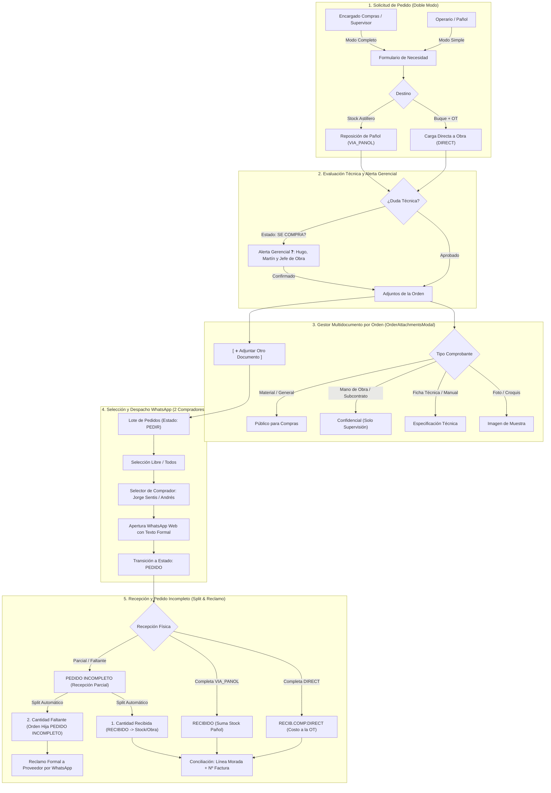

# Módulo 4b: Compras y Proveedores

> **Módulo:** M4b — Compras & Logística de Insumos  
> **Estado:** ✅ Implementado, Ajustado y Operativo  
> **Ruta en App:** `/compras`  
> **Panel de Configuración:** `/admin` (Tab *"Config. Compras & WhatsApp"*)  
> **Referencia Legacy:** Planilla GS-006 (`1k1BBl1pAf8HlGfiNzSt5xGHpkgQw1dD3tWERTYhu3MY`)  
> **Migraciones SQL:** `0024_create_suppliers_and_purchase_orders.sql`, `0025_purchase_orders_enhancements.sql` y `0026_purchase_orders_adjustments.sql`

---

## 1. Visión General y Flujo Operativo

El **Módulo de Compras (M4b)** digitaliza integralmente la planilla GS-006 del astillero, optimizando el circuito diario de aprovisionamiento de materiales, gases industriales, fijaciones y consumibles navales.



---

## 2. Componentes de UI y Estándares Mandatorios

### 2.1. Inmovilización de Encabezados (Sticky Header tipo Excel)
La cabecera de la tabla permanece congelada en la parte superior (`sticky top-0 z-20 bg-slate-950`) durante todo el desplazamiento vertical de la grilla, permitiendo leer columnas y acceder a los selectores maestros sin perder el contexto.

### 2.2. Nuevo Orden Oficial de Columnas en la Planilla de Compras
La grilla implementa estrictamente la secuencia operativa solicitada:
1. **`[ ]`**: Casilla de selección masiva.
2. **`DESTINO`**: `PAÑOL / STOCK` vs `DIRECTO` vs `STANDBY`.
3. **`FECHA / QUINCENA`**: Fecha del pedido y período quincenal contable.
4. **`BUQUE / OT`**: Buque y Orden de Trabajo (con descripción completa desplegable).
5. **`SOLICITA`**: Solicitante por defecto "PAÑOL" u operario habilitado *(editable con doble clic)*.
6. **`MATERIAL SOLICITADO`**: Nombre del material + botón de alta rápida si es nuevo.
7. **`CANT.`**: Cantidad y unidad de medida deducida *(editable con doble clic)*.
8. **`$/U PROVEEDOR`**: Costo cotizado AR$ *(Modo Completo, editable con doble clic)*.
9. **`$/U SISTEMA`**: Costo catálogo AR$ y comparador porcentual *(Modo Completo)*.
10. **`PROVEEDOR`**: Proveedor asignado *(visible en ambos modos, editable con doble clic)*.
11. **`ESTADO`**: Selector de estado interactivo *(editable en ambos modos)*.
12. **`URGENCIA`**: `Sin Apuro` / `Urgente` / `Próx. Salida` *(conmutable en 1 clic)*.
13. **`DOC`**: Botón con contador `📎 (N)` que abre el gestor multidocumento.
14. **`CONCILIADO`**: Línea morada y registro de factura *(Modo Completo)*.
15. **`ACCIONES`**: Botón de edición modal y eliminación.

### 2.3. Edición en Celda por Doble Clic (Estilo Excel / Google Sheets)
Se implementó *Inline Cell Editing* reactivo in-situ:
- **$/U Proveedor:** Doble clic $\rightarrow$ se transforma en input numérico $\rightarrow$ `Enter` o `Blur` guarda en Supabase inmediatamente recalculando los totales.
- **Proveedor:** Doble clic $\rightarrow$ se transforma en menú select de proveedores $\rightarrow$ selección guarda al instante.
- **Cantidad:** Doble clic $\rightarrow$ input numérico $\rightarrow$ `Enter` guarda.
- **Solicita:** Doble clic $\rightarrow$ input de texto $\rightarrow$ `Enter` guarda.
- **Escape:** Cancela la edición y restaura el valor original sin alterar la base de datos.

### 2.4. Doble Modo de Interfaz: Solicitud Simple vs Gestión Completa
- **Modo Solicitud Simple (`viewMode = 'simple'`):** Diseñado para pañoleros y jefes de obra. Permite filtrar y visualizar la columna **PROVEEDOR** (indispensable para cotejar remitos en el portón), y cuenta con selector de **ESTADO EDITABLE** con las opciones de recepción física (`PEDIR`, `RECIBIDO`, `RECIB.COMP.DIRECT`, `PEDIDO INCOMPLETO`, `RECIBIDO 2`, `CANCELADOS`, `SE COMPRA?`).
- **Modo Gestión Completa (`viewMode = 'completa'`):** Vista integral para el Encargado de Compras y Supervisión, con costos unitarios, cotizaciones comparadas, facturación y conciliación.

### 2.5. KPIs Superiores por Grupos y Subgrupos (Filtros Reactivos 1-Clic)
Seis tarjetas ejecutivas organizadas funcionalmente:
1. **🟡 Por Emitir:** Total (`PEDIR` + `SOLICITUD`) con sub-botones independientes para filtrar `PEDIR` o `SOLICITUD`.
2. **🟣 Cotizaciones:** Total con sub-botones por etapa: `COTIZAR` (a pedir precio), `SOLICITUD` (esperando proveedor), `EVAL.` (cotizaciones en análisis) y `APROB.` (aprobadas).
3. **🔵 En Proveedor & Tránsito:** Total en curso (`PEDIDO`) y sub-botón destacado para `PEDIDO INCOMPLETO` (recepciones parciales pendientes de reclamo).
4. **❓ En Decisión (SE COMPRA?):** Conteo de compras en duda técnica con alerta a Hugo, Martín y Jefe de Obra.
5. **🟢 Recibidos:** Total ingresado con desglose de Pañol, Obra y compras conciliadas con factura.
6. **🚨 Reposición Gases P-02:** Parámetros de corte semanal Air Liquide (martes <12hs, cliente 2234867, tel 0810-222-5272).

### 2.6. Barra Inferior Flotante de Alto Contraste y Acciones Masivas
Diseño de alto contraste (`border-2 border-cyan-400 bg-slate-900/98 shadow-2xl shadow-cyan-500/30`):
- **Alerta de Filtros Activos:** Si hay cualquier filtro aplicado, muestra una insignia ámbar: `⚠️ Filtro Activo: Mostrando X de Y pedidos` con botón de alto contraste: **`[ ✕ Limpiar Todos los Filtros ]`** (también disponible en la barra de búsqueda superior).
- **Acciones en Lote:**
  - `[ 🛒 Pedir Agrupado (N) ]`: Despacho por WhatsApp Web.
  - `[ 🏢 Asignar Proveedor (N) ]`: Asignación rápida de proveedor a múltiples pedidos en 1 clic.
  - `[ ✅ Recibir (N) ]`: Recepción masiva automática.

---

## 3. Circuitos Especiales y Modales

### 3.1. Gestor Multidocumento de la Línea (`OrderAttachmentsModal`)
Permite adjuntar múltiples comprobantes (Cotización de Material, Ficha Técnica, Fotos de Muestras, Remitos) a una misma orden de compra:
- Lista todos los archivos asociados con etiquetas de tipo, tamaño y fecha.
- Acciones por archivo: Ver (`👁️`), Modificar Metadatos (`✏️`), Reemplazar Binario (`🔄`) y Eliminar (`🗑️`).
- Formulario integrado **`[ ➕ Adjuntar Otro Documento a esta Orden ]`** para subir nuevos archivos sin sobreescribir los existentes.

### 3.2. Circuito de Pedido Incompleto (División Limpia & Reclamo)
Cuando el pañolero marca un pedido como `PEDIDO INCOMPLETO`:
1. Se abre el modal **"Recepción Parcial de Mercadería"**.
2. Ingresa la **Cantidad Recibida** (ej. 18 de 20), el sistema calcula automáticamente la **Cantidad Faltante** (2).
3. Solicita obligatoriamente el **Nº de Remito** y permite subir fotos del remito y de la mercadería recibida como evidencia.
4. **División Automática (Split):**
   - La orden original se actualiza a 18 unidades con estado `RECIBIDO` (o `RECIB.COMP.DIRECT`), sumando stock o imputando costo a la obra.
   - Se crea automáticamente una orden hija por las 2 unidades faltantes con estado `PEDIDO INCOMPLETO` y el número de remito registrado.
5. **Reclamo en Compras:**
   Al seleccionar órdenes incompletas para enviar por WhatsApp, el sistema redacta automáticamente la plantilla oficial de reclamo:
   > *"Estimados [Proveedor], acusamos recibo de la entrega para Astillero Alon Car correspondiente a la orden de compra del día [Fecha Pedido] según Remito N° [Remito].  
   > Sobre el pedido de 20 unidades de [Material], se recibieron físicamente 18 unidades.  
   > Quedan pendientes de entrega 2 unidades.  
   > Agradecemos nos confirmen la fecha estimada de despacho del saldo faltante.  
   > Atte. Departamento de Compras Alon Car S.A."*

### 3.3. Alerta Gerencial "SE COMPRA?"
Al marcar una orden como `SE COMPRA?`:
- Se guarda el estado y se abre la ventana de alerta gerencial.
- Notifica a los destinatarios configurados en Administración:
  - **Hugo Sentis** (Gerente General).
  - **Martín Sentis** (Gerente de Operaciones).
  - **Jefe de Obra** (detectado automáticamente según la OT elegida).
- Permite enviar el aviso por WhatsApp con 1 clic con los datos del material, buque y costo.

---

## 4. Configuración Centralizada en el Administrador (`/admin`)

En la pestaña **"Config. Compras & WhatsApp"** (`ComprasSettingsPanel.jsx`) se configuran:
1. **Comprador 1 (Jorge Sentis):** Nombre, Celular WhatsApp, Rol y Estado.
2. **Comprador 2 (Andrés):** Nombre, Celular WhatsApp, Rol y Estado.
3. **Destinatarios de Alerta "SE COMPRA?":** Configuración de datos de contacto de Hugo, Martín y Jefe de Obra.
4. **Saludo Predeterminado y Normalización Telefónica:** Parámetros de envío para WhatsApp Web.

---

## 5. Modelo de Base de Datos y Migración 0026

```sql
-- Columnas añadidas para Pedido Incompleto y Trazabilidad de Remitos
ALTER TABLE public.purchase_orders 
  ADD COLUMN IF NOT EXISTS remito_number TEXT,
  ADD COLUMN IF NOT EXISTS parent_order_id UUID REFERENCES public.purchase_orders(id) ON DELETE SET NULL,
  ADD COLUMN IF NOT EXISTS received_quantity NUMERIC(10,2),
  ADD COLUMN IF NOT EXISTS missing_quantity NUMERIC(10,2);

-- Soporte ampliado de tipos de documento en Storage
ALTER TABLE public.purchase_documents 
  ADD CONSTRAINT purchase_documents_doc_type_check CHECK (doc_type IN (
    'COTIZACION_MATERIAL', 'COTIZACION_MANO_OBRA', 'FICHA_TECNICA',
    'IMAGEN_MUESTRA', 'REMITO_FACTURA', 'FACTURA', 'REMITO'
  ));
```
