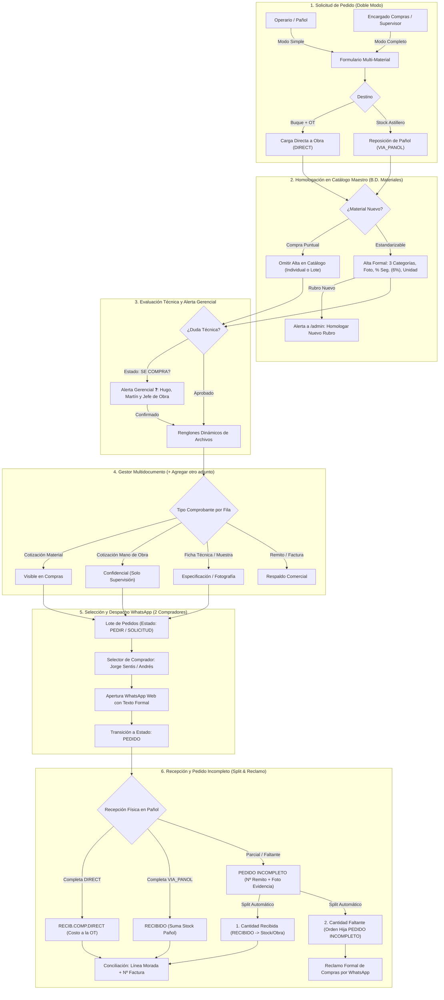

# Módulo 4b: Compras y Proveedores

> **Módulo:** M4b — Compras & Logística de Insumos  
> **Estado:** ✅ Implementado, Ajustado y Operativo  
> **Ruta en App:** `/compras`  
> **Panel de Configuración y Alertas:** `/admin` (Tabs *"Config. Compras & WhatsApp"* y *"Alertas"*)  
> **Referencia Legacy:** Planilla GS-006 (`1k1BBl1pAf8HlGfiNzSt5xGHpkgQw1dD3tWERTYhu3MY`)  
> **Migraciones SQL:** `0024_create_suppliers_and_purchase_orders.sql`, `0025_purchase_orders_enhancements.sql`, `0026_purchase_orders_adjustments.sql` y `0027_compras_catalog_and_attachments.sql`

---

## 1. Visión General y Flujo Operativo

El **Módulo de Compras (M4b)** digitaliza integralmente la planilla GS-006 del astillero, optimizando el circuito diario de aprovisionamiento de materiales, gases industriales, fijaciones y consumibles navales.

---

## 2. Componentes de UI y Estándares Mandatorios

### 2.1. Inmovilización de Encabezados (Sticky Header tipo Excel)
La cabecera de la tabla permanece congelada en la parte superior (`sticky top-0 z-20 bg-slate-950`) durante todo el desplazamiento vertical de la grilla.

### 2.2. Orden Oficial de Columnas en la Planilla de Compras
1. **`[ ]`**: Casilla de selección masiva.
2. **`DESTINO`**: `PAÑOL / STOCK` vs `DIRECTO` vs `STANDBY`.
3. **`FECHA / QUINCENA`**: Fecha del pedido y período quincenal contable.
4. **`BUQUE / OT`**: Buque y Orden de Trabajo (con descripción completa visible).
5. **`SOLICITA`**: Solicitante por defecto "PAÑOL" u operario habilitado *(editable con doble clic)*.
6. **`MATERIAL SOLICITADO`**: Nombre del material + insignia `Alta` (si requiere alta en B.D. Maestra y no fue descartado).
7. **`CANT.`**: Cantidad y unidad de medida deducida *(editable con doble clic)*.
8. **`$/U PROVEEDOR`**: Costo cotizado AR$ *(Modo Completo, editable con doble clic)*.
9. **`$/U SISTEMA`**: Costo catálogo AR$ y comparador porcentual *(Modo Completo)*.
10. **`PROVEEDOR`**: Proveedor asignado *(visible en ambos modos, editable con doble clic + buscador por iniciales)*.
11. **`ESTADO`**: Selector de estado con fondo neutro oscuro (`bg-slate-950`) que colorea exclusivamente el nombre del estado *(editable en ambos modos)*.
12. **`URGENCIA`**: `Sin Apuro` / `Urgente` / `Próx. Salida` *(conmutable en 1 clic)*.
13. **`DOC`**: Botón con contador `📎 (N)` que abre el gestor multidocumento dinámico.
14. **`CONCILIADO`**: Línea morada y registro de factura *(Modo Completo)*.
15. **`ACCIONES`**: Botón de edición modal y eliminación.

### 2.3. Edición en Celda por Doble Clic y Buscador de Proveedor (`InlineSupplierPicker`)
- **Proveedor (Buscador para 300+ Proveedores):** Doble clic abre un buscador flotante con foco automático donde el comprador escribe las iniciales del nombre o rubro, filtrando en vivo y permitiendo seleccionar con `Flechas + Enter` o clic.
- **$/U Proveedor, Cantidad y Solicita:** Doble clic convierte la celda en campo editable in-situ; `Enter` o `Blur` guarda en Supabase sin abrir modales (`Escape` cancela).

### 2.4. KPIs Superiores por Grupos y Subgrupos (7 Tarjetas Interactivas 1-Clic)
1. **1. Por Emitir:** Total (`PEDIR` + `SOLICITUD`) con sub-botones individuales.
2. **2. Cotizaciones:** Total con sub-botones: `COTIZAR`, `SOLIC.`, `EVAL.` y `APROB.`.
3. **3. En Proveedor:** Total en tránsito (`PEDIDO` + `PEDIDO INCOMPLETO`) con sub-botones individuales para filtrar `PEDIDO` o `Incomp.` tanto en vista simple como completa.
4. **4. SE COMPRA?:** Compras en duda técnica con alerta gerencial a Hugo Sentis, Martín Sentis y Jefe de Obra.
5. **5. Alta Catálogo:** Materiales nuevos pendientes de alta en B.D. Maestra (`is_new_material = true` y `no_catalog_required = false`).
6. **6. Recibidos:** Total ingresado (Pañol / Obra) y sub-botón de facturados/conciliados.
7. **7. Gases P-02:** Filtro rápido para proveedores de gases industriales (Air Liquide / Praxair Linde).

### 2.5. Barra Inferior Flotante de Alto Contraste y Acciones Masivas
- **Alerta de Filtros Activos:** Insignia ámbar `⚠️ Filtro Activo (X de Y)` con botón **`[ ✕ Limpiar Todo ]`**.
- **Acciones en Lote (al seleccionar 1 o más filas):**
  - `[ 💬 Pedir Agrupado (N) ]`: Despacho o reclamo agrupado por proveedor vía WhatsApp Web.
  - `[ 🏢 Asignar Proveedor (N) ]`: Asignación masiva con buscador por iniciales.
  - `[ 🚫 Omitir Alta Catálogo (N) ]`: Descarta en bloque el aviso de alta para materiales puntuales/descartables (`no_catalog_required = true`).
  - `[ ✅ Recibir (N) ]`: Recepción masiva.

### 2.6. Motor de Hoja de Cálculo (Google Sheets / Excel Grid — `useSpreadsheetGrid`)
Para eliminar clics innecesarios y operar a la velocidad de una planilla de cálculo profesional:
- **Navegación Fluida:** Flechas (`↑`, `↓`, `←`, `→`) para caminar entre celdas; `Shift + Flechas` o arrastre con mouse para seleccionar rangos verticales u horizontales.
- **Tirador de Arrastre (*Fill Handle*):** Cuadradito cian en la esquina inferior derecha (`cursor: crosshair`) para arrastrar hacia abajo y clonar datos, con soporte de **doble clic para auto-rellenar** hasta la última fila contigua.
- **Comandos Rápidos:**
  - **`Ctrl + C` / `Ctrl + V`:** Copiar y pegar datos en celdas individuales o rangos completos.
  - **`Ctrl + D`:** Rellena hacia abajo (*Fill Down*) replicando el valor de la celda superior en todas las celdas seleccionadas por debajo.
  - **`Ctrl + Z` (Deshacer) / `Ctrl + Y` (Rehacer):** Pila histórica bidireccional de hasta 50 pasos por sesión y usuario; revierte o re-aplica cambios visualmente y en Supabase en un único lote. Cuenta con botones visibles **`[ ↩ Deshacer (Ctrl+Z) ]`** y **`[ ↪ Rehacer (Ctrl+Y) ]`**.
  - **`Ctrl + F`:** Atajo al buscador de compras seleccionando el texto para filtrar al instante sin usar el mouse.

---

## 3. Circuitos Especiales y Modales

### 3.1. Alta Formal de Material en B.D. Maestra (`NewMaterialModal`)
- **Casilla de Descarte Individual:** `[ ] No requiere alta en catálogo (Desactivar aviso para este pedido)` para compras únicas que no deben contaminar el catálogo maestro.
- **Categorías Estrictas (Únicas 3):** `MATERIALES`, `CONSUMIBLES`, `ELEM.SEGURIDAD`.
- **Unidad de Medida en Desplegable:** `Unidad`, `m2 (Lado x Lado)`, `Metro Lineal`, `kg`, `m3`, `Litros`, `Caja`, `Bolsón`, `Rollo`, `Barra`, `Chapa`, `Tubo`, `Pieza`.
- **% Seguridad (Merma / Buffer Naval):** Por defecto **6%** (`1.06`), desplegable entre `2%`, `6%`, `10%`, `15%`, `20%` y `30%`.
- **Fotografía del Material (`image_url`):** Subida directa a Supabase Storage (`compras/catalogo_materiales/`) para la ficha visual de Pañol.
- **Solicitud de Apertura de Nuevo Rubro:** Al tildar `[x] Solicitar apertura de nuevo rubro`, habilita una casilla de texto libre para proponer el rubro, guarda el material con `rubro_status = 'PENDIENTE_HOMOLOGACION'` y genera una alerta en la pestaña **Alertas** de `/admin` para que el Administrador apruebe o asigne el rubro definitivo en 1 clic. *(Nota: Al construir el Módulo Pañol, este selector se vinculará directamente con la tabla maestra de rubros de Pañol).*

### 3.2. Subida Multi-Adjuntos Dinámica (`+ Agregar otro adjunto`)
Tanto en `OrderAttachmentsModal` como en `UploadDocModal`:
- Lista todos los archivos existentes de la orden sin sobreescribirlos (con botones para Ver, Editar Metadatos, Reemplazar o Eliminar).
- Incluye el botón **`[ + Agregar otro adjunto ]`** (al estilo de pedido de materiales y carga de horas), que añade renglones dinámicos para subir múltiples archivos de una sola vez, permitiendo elegir el **Tipo de Documento** (`Cotización de Material`, `Cotización de Mano de Obra`, `Ficha Técnica`, `Muestra / Foto`, `Remito`, `Factura`) y descripción para cada archivo individual.

### 3.3. Circuito de Pedido Incompleto (División Limpia & Reclamo)
1. **Pañolero:** Al recibir menos unidades de las pedidas, selecciona `PEDIDO INCOMPLETO`, ingresa la cantidad recibida física, el **Nº de Remito obligatorio** y sube foto/evidencia del remito.
2. **División Automática (Split):** La orden original pasa a `RECIBIDO` por la cantidad entregada (sumando a stock si corresponde) y se crea una orden hija en `PEDIDO INCOMPLETO` por el saldo faltante.
3. **Compras (Reclamo Formal por WhatsApp):** Al pulsar pedir agrupado sobre ítems incompletos, el sistema precarga automáticamente el mensaje de reclamo oficial de Alon Car S.A. citando fecha de pedido, Nº de remito, cantidad pedida, recibida y pendiente.
