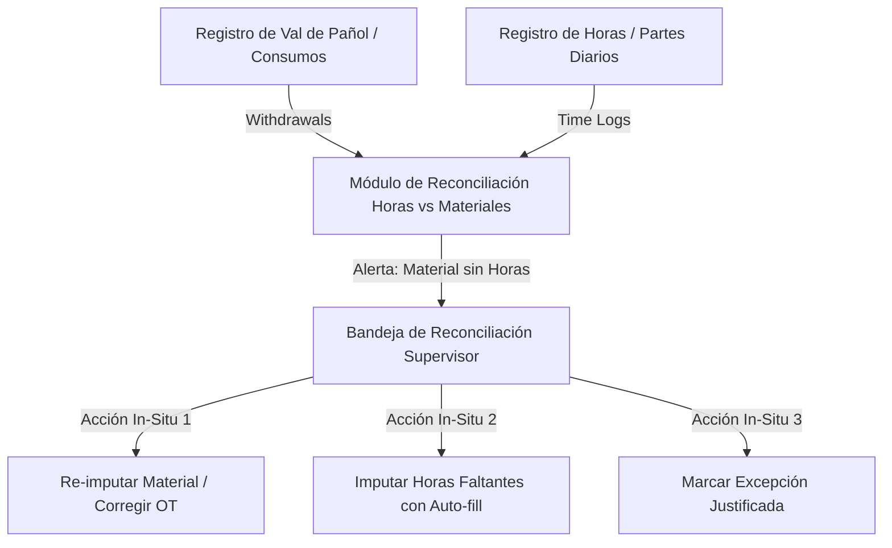

# Mapeo Legacy: Reconciliación de Horas vs Materiales (BD_Nuevas_Planillas & Imputación Horas vs Materiales)

> [!IMPORTANT]
> **Fuentes de información cruzadas:** Descripción del usuario (sesión 2026-08-21 e inspección ampliada del 2026-11-27), extracción técnica directa vía Google Sheets API (v4) de `BD_Nuevas_Planillas` (`19akjKRBGHHVw1OwxGhJc71IYFxK5Fd6JeCRpDMaqThs`), `Imputación horas vs materiales` versión histórica (`1fpkRbhbeIpykepnRTcJGhgVPOwNhg88qkauWFBU2F3o`) y **versión viva en producción (`1x7pfn7m2tA8iN1MzVA-my2q0wMSRDHb40tuZQamsYlc`, inspeccionada el 2026-11-27)**, y decisión de producto `DEC-025`.

---

## PARTE A: Diseño Técnico (Para IA / App)

### 1. Clasificación de las Planillas
- **IDs de Planillas:** 
  - `GS-009`: `BD_NUEVAS_PLANILLAS`
  - `GS-010`: `IMPUTACION_HORAS_VS_MATERIALES`
- **Tipo de Planilla:** TIPO D (Híbrida)
- **Justificación:** Son planillas de transformación y auditoría quincenal. Importan retiros de pañol y registros de horas via `IMPORTRANGE`, construyen llaves compuestas de coincidencia y generan una matriz visual de alertas (`AVISO = "NO"`) para detectar fugas de facturación o errores de imputación antes de cerrar la quincena.
> Confianza: CONFIRMADO (Inspeccionado vía API)

---

### 2. Identidad y Contexto de Negocio
- **URL GS-009:** `https://docs.google.com/spreadsheets/d/19akjKRBGHHVw1OwxGhJc71IYFxK5Fd6JeCRpDMaqThs/edit`
- **URL GS-010 (Producción actual, verificado 2026-11-27):** `https://docs.google.com/spreadsheets/d/1x7pfn7m2tA8iN1MzVA-my2q0wMSRDHb40tuZQamsYlc/edit` *(versión histórica anterior: `https://docs.google.com/spreadsheets/d/1fpkRbhbeIpykepnRTcJGhgVPOwNhg88qkauWFBU2F3o/edit`)*
- **Configuración regional verificada (GS-010):** `locale: es_AR`, `timeZone: America/Buenos_Aires`
- **Departamento Propietario:** Operaciones / Administración / Pañol / Control de Gastos
- **Usuarios Principales y Rol:** Controlador de Gastos / Administrador, Supervisor de Obra, Pañolero, Liquidador de Sueldos.
- **Propósito Principal:** Realizar la auditoría cruzada quincenal previa a la liquidación para garantizar que **todo material retirado de pañol para un Barco y Orden de Trabajo tenga respaldada su respectiva carga de horas de mano de obra** (y revisar complementariamente horas sin material cuando corresponda).
- **Frecuencia de Uso:** Cierre quincenal (previo al pago) y revisiones semanales de control.

---

### 3. Estructura Visual y Mecanismo de Alerta Legacy

#### A. Hojas Relevantes Extraídas (6 pestañas verificadas en `GS-010` + 3 en `GS-009`)
1. `ALERTA` (`GS-010`, solapa roja): Tablero principal de cruce que compara llaves de Horas vs retiros individuales de Materiales para la quincena seleccionada en `B1`.
2. `IMPORT.HORAS` (`GS-010`): Importación cruda de partes diarios de horas desde planilla externa (`15EToabTiNc4pf9xAd3Vthq0HwtN6xr4XciXWRTsbz70`, `HORAS!a19000:D`), cálculo de quincena (`día < 16` → `1RA`, si no `2DA`), homologación de contratista contra `TABLA DE CONVERSION` (`$A$3:$C$203`) y generación de llave `CODIGO`.
3. `IMPORT.MAT.CONVERSOR` (`GS-010`): Importación de retiros de pañol desde la misma planilla externa (`MATERIALES!a23000:C` y `MATERIALES!D23000:D`), traducción de `RESPONSABLE DE RETIRO` → `CONTRATISTA` vía `VLOOKUP` contra `'TABLA DE CONVERSION'!A$1:C$224`, con vista de filtro `"contratista vacio"`.
4. `IMPORT.MATERIALES` (`GS-010`): Trae `IMPORT.MAT.CONVERSOR!B2:E` mediante self-`IMPORTRANGE` en `A5`, aplica en `F4` un `FILTER` con ~50 exclusiones hardcodeadas (contratistas/talleres sin parte diario, clientes `CORMETAL`, `INTECO`, `LIFTER` y OTs administrativas `PROV.CONSUMIBLES`, `Camion-auto`, `oficina`, `Taller Carpint`, `AGUA`, `MULITA`, `DONACION`, `PROVISION CARLOS MAYO`, `DESPERDICIO HORAS`), calcula quincena y arma llave `CODIGO`.
5. `TABLA DE CONVERSION` (`GS-010`): 91 entradas activas importadas con `=UNIQUE(IMPORTRANGE(...))` desde `B.D.NewSystemm` (`1OHFCkWKOwaknei6eV6wBZrEXHlye2QK3RJUqC0yDT-4`, `BaseDatosP/PlanillasRegistro!as3:at200`) más 2 filas manuales superiores (`OMAR`, `SEN SRL`). Agrupa **36 operarios propios y grúas bajo `ASTILLERO`** y conserva **55 contratistas/talleres por su nombre**.
6. `CALCULOS.VARIOS` (`GS-010`, *oculta*): Genera el rango nombrado `QUINCENA` (`A1:A100`) para el desplegable `ALERTA!B1` y calcula en `E2` `#CONTEO DE DATOS ERRONEOS = COUNTIF(ALERTA!D:D;"NO")`.
7. `B.D PERSONAL` (`GS-009` - TAB-001): Padrón maestro de personal y permisos.
8. `HORAS.B.D.INTERM.O.T.DESPLEGLABLE` (`GS-009` - TAB-002): Matriz de validación Barco/OT para Horas.
9. `TERCEROS.B.D.INTERM.O.T.DESPLEGLABLE` (`GS-009` - TAB-003): Matriz de validación Barco/OT para Terceros.
*(Nota: Pestaña `B.D.O.TRABAJO` desestimada por estar en proceso de reemplazo por arquitectura relacional).*

#### B. Construcción de Llave Compuesta de Coincidencia
Tanto en `IMPORT.MATERIALES` (col `O`) como en `IMPORT.HORAS` (col `L`), el sistema genera una columna `CODIGO` que concatena 4 dimensiones clave:
```excel
=IF(A4="";"";CONCATENATE(N4;"/";G4;".";H4;".";I4))
```
- **Formato:** `[QUINCENA]/[BARCO].[ORDEN DE TRABAJO].[CONTRATISTA]`
- **Cálculo de Quincena:** `=IF(día<16;"1RA";"2DA")` + `TEXT(fecha;"MMM")` + `YEAR(fecha)`.
- **Ejemplo Real Extraído:** `2DA ago 2026/DON VICENTE VUOSO.ALARGUE MODIFICACION.RAMON ARANDA` / `2DA nov 2026/DON ANTONIO.CAMBIOS DE CHAPA.ASTILLERO`.

#### C. Lógica de Alerta en Hoja `ALERTA`
- **Celda `B1`:** Selector desplegable validado contra `=CALCULOS.VARIOS!$A$2:$A$100` (ej. `2DA nov 2026`).
- **Columna A (`CODIGO HORAS`):** Lista única de combinaciones con horas registradas en la quincena (`=UNIQUE(FILTER(IMPORT.HORAS!L4:L;IMPORT.HORAS!A4:A<>"";IMPORT.HORAS!J4:J=B1))`).
- **Columna B (`CODIGO MATERIALES`):** Lista **sin `UNIQUE`** de todos los retiros de materiales en la quincena (`=FILTER(IMPORT.MATERIALES!O4:O; ...)`). **Decisión intencional de negocio:** no se deduplica porque cada línea representa un retiro real de material y permite al controlador dimensionar exactamente cuántas líneas revisar. Incluye además una segunda lista hardcodeada de 10 contratistas excluidos (`ARMADOR`, `LESIN S.A`, `GRUPO GLAM`, `GUILLERMO GARCIA`, `4RG SERV. INDUSTRIALES`, `LEO ZOLOA`, `HP HIDRAULICA`, `RODRIGO TORRES`, `PABLO N.`, `ELECTRICIDAD NAVAL SA`) y formato condicional amarillo cuando la celda contiene `"TALLER"`.
- **Columna C (`ALERTA`):** Inserta un `VLOOKUP` para verificar si la llave del material existe en las horas:
  ```excel
  =IF(B4="";"";IFERROR(VLOOKUP(B4;$A$4:$A$9009;1;FALSE)))
  ```
- **Columna D (`AVISO`):** Muestra **`"NO"`** si la llave de material no tiene correspondencia en horas (`=IF(C4=B4;"OK";"NO")`). Se inspecciona usando la vista de filtro `"ERROR DE IMPUTACION"` que oculta los `"OK"`.

#### D. Filtros Excluyentes Legacy vs Regla Integral en la App
- **En la Planilla Legacy:** `IMPORT.MATERIALES` (~50 condiciones en `FILTER`) y `ALERTA` (10 condiciones adicionales, parcialmente solapadas) excluían manualmente talleres externos sin parte diario y OTs administrativas internas porque no se disponía de un cruce relacional limpio en Google Sheets.
- **En la App (Regla Unificada DEC-025 + Actualización 2026-11-27):** Se eliminan las listas hardcodeadas en fórmulas. Los talleres que no imputan partes diarios (`workers.can_impute_hours = false`) se excluyen automáticamente del cruce con horas (pudiendo cruzarse aparte contra `third_party_services` / OTs asignadas), mientras que toda entidad que sí registra horas (`ASTILLERO` vía `work_group` o contratista) se audita línea por línea.

#### E. Deuda Técnica y Observaciones Detectadas (Inspección `2026-11-27`)
En la fotografía inspeccionada (`2DA nov 2026`) se registraron **135** llaves únicas de horas y **606** líneas de retiros de materiales: **500 `OK`** y **106 `NO`** (agrupadas en 35 combinaciones Barco/OT/Contratista). Se detectaron 5 fuentes de fragilidad operativa:
1. **15 alertas vacías (`2DA nov 2026/..`):** Filas en origen con fecha `27/11/2026` sin Cliente/OT/Contratista y desfasaje estructural en `IMPORT.MATERIALES` (`IMPORTRANGE` comienza en `A5` mientras el `FILTER` en `F4` comienza en fila 4).
2. **Responsables sin mapear rompen la llave:** Quienes retiran material sin figurar en `TABLA DE CONVERSION` (ej. `SABRINA`, `PABLO N.`) producen `IFERROR` vacío y llaves truncas terminadas en punto (ej. `2DA nov 2026/ASTILLERO.SUPERVISION.`), generando falsos `NO`.
3. **Asimetría de rango en `TABLA DE CONVERSION`:** `IMPORT.HORAS` busca en `$A$3:$C$203` (omitiendo las filas manuales `1–2` donde está `OMAR`), mientras `IMPORT.MAT.CONVERSOR` busca en `A$1:C$224`.
4. **Rangos de corte manuales y self-`IMPORTRANGE`:** `HORAS!a19000:D` y `MATERIALES!a23000:D` dependen de actualizar filas iniciales manualmente; `IMPORT.MATERIALES` importa vía `IMPORTRANGE` desde el mismo archivo (`IMPORT.MAT.CONVERSOR!B2:E`), agregando latencia innecesaria.
5. **Exclusiones repartidas y duplicadas:** Los filtros de contratistas excluidos están divididos entre `IMPORT.MATERIALES!F4` y `ALERTA!B4` con nombres repetidos entre ambas listas.

---

### 4. Mapa Relacional de Dependencias



---

## PARTE B: Lógica de Negocio (Para Humanos)

### Propósito y Uso en la Vida Real
Al final de cada quincena (antes de liquidar sueldos y facturar a contratistas), el supervisor debe garantizar que no existan **fugas de información**. Si un taller o contratista retiró discos de corte, electrodos o tuberías para un barco y orden de trabajo específica, es indispensable que existan horas de trabajo registradas para esa tarea. Si un contratista retiró material pero no cargó horas, representa un costo de material entregado sin control de mano de obra.

### El Dolor Legacy: "El Baile entre Planillas"
Actualmente, resolver una alerta `AVISO = "NO"` requiere un proceso manual tedioso:
1. El supervisor filtra la columna `AVISO` por `"NO"` en la pestaña `ALERTA`.
2. Copia la llave del error (ej. `DON VICENTE VUOSO.PROA MODIFICACION.RAMON ARANDA`).
3. Abre la planilla de Materiales de la quincena, busca al contratista y revisa qué insumo retiró para ver si fue un error de tipeo del pañolero.
4. Si duda, abre la planilla de Horas de la quincena para revisar qué tareas reportó el contratista ese día.
5. Edita manualmente las celdas en las distintas planillas y regresa a la hoja `ALERTA` a verificar que el aviso cambie a `"OK"`.

### La Solución en la App (Panel de Reconciliación e Imputación In-Situ)
La App reemplazará por completo las planillas de cruce mediante una **Bandeja de Reconciliación Automática en Tiempo Real**:

1. **Conciliación Relacional Automática:** El backend (Supabase) cruza constantemente los retiros de pañol (`Consumption`) contra la carga de horas (`TimeImput`) y las asignaciones de trabajo (`WorkOrder`).
2. **Alertas Clarificadas:** Se despliegan tarjetas de inconsistencia etiquetadas como **`⚠️ Material sin Carga de Horas / Trabajo Reportado`**.
3. **Resolución en un Clic (In-Place Editing):**
   - **Asistencia Contextual (Vista Rápida):** El sistema asiste al supervisor mostrando las horas que SÍ cargó ese operario/taller en esa semana, brindando contexto inmediato para descubrir si hubo un error de tipeo en la OT sin ir a buscar a otra planilla.
   - **Boton ✏️ Corregir Imputación de Material:** Permite corregir la OT o el Barco del retiro de pañol desde la misma pantalla en caso de error del pañolero.
   - **Boton ➕ Cargar Horas Faltantes:** Abre el formulario de carga de horas con el Barco, OT, Taller y Fecha **pre-completados automáticamente**.
   - **Boton 🛡️ Excepción Justificada:** Permite autorizar retiros especiales sin horas adjuntando una justificación breve.

### Actualización y Reglas Confirmadas para App AlonCar (2026-11-27 — Módulo `Control de Gastos`)
A partir de la revisión operativa con el Controlador de Gastos, quedan confirmadas las siguientes definiciones funcionales para el futuro módulo en la App:
1. **Módulo Nuevo Independiente (`Control de Gastos`):** Clasificado como **`CARGA_EDICION` (Gallo)**, con trazabilidad obligatoria en `audit_logs` sobre toda corrección realizada en Materiales o en Horas.
2. **Acceso y Permisos:** Visible por defecto únicamente para el rol **Administrador**, pero registrado explícitamente en la matriz de permisos (`allowedSections`) para poder habilitar otros usuarios si se requiere.
3. **Granularidad Línea por Línea:** En el cruce de Materiales ➔ Horas se lista y contabiliza **cada línea individual de retiro de material** (`inventory_transactions`, sin deduplicar), para reflejar con exactitud cuántas líneas faltan revisar.
4. **Cruce Principal y Comparador Complementario:**
   - **Vista principal (`Materiales sin Horas`):** Detecta retiros de material sin horas imputadas en la quincena para la misma combinación Buque + OT + Contratista (personal propio unificado bajo `workers.work_group = 'ASTILLERO'`).
   - **Comparador complementario (`Horas sin Materiales`):** Lista horas imputadas que no registran retiros de material, incorporando un **check rápido `✓ Aprobado`** para validar trabajos legítimos de solo mano de obra.
5. **Talleres sin Parte Diario (`workers.can_impute_hours = false`):** Se excluyen automáticamente del cruce contra horas (eliminando los filtros hardcodeados) y quedan disponibles para cruzarse por separado contra `third_party_services` / OTs asignadas.
6. **Filtros Obligatorios en Zona 1:** Selectores directos de **Quincena**, **Contratista** (acompañado de cola rápida de contratistas con pendientes) y **Barco**.
7. **Mesa Dividida Sincronizada y Flujo de Corrección:**
   - **Panel izquierdo (Materiales con `NO`):** Selección múltiple y edición in-situ (individual o en lote) de **`Fecha ✎`**, **Buque `✎`** y **OT `✎`**. La edición directa de fecha resuelve retiros cargados el día posterior al cierre de quincena (al pasar la fecha a la quincena anterior el registro re-concilia automáticamente), acompañada de una pista visual cuando esa OT coincide en otro barco y de una pista automática del motor **`📅 Coincide en quincena anterior (último día)`** cuando no hay horas en la quincena vigente pero sí existieron en la inmediata anterior.
   - **Panel derecho (Espejo de Horas del Contratista):** Muestra en paralelo **qué hizo ese mismo día** y el **mapa de toda la quincena en todos los barcos**, permitiendo detectar rápidamente errores tanto de OT como de **Barco** cuando trabajos similares coinciden en distintas embarcaciones.
   - **Edición bidireccional:** Permite corregir directamente sobre Materiales o sobre Horas, según dónde esté el error de origen (incluyendo aplicar Buque/OT de una fila de horas sobre las líneas de material seleccionadas).
   - **Acción `Desdoblar fila de horas` (Split):** Para trabajos chicos donde las horas quedaron absorbidas en otro ítem del día pero hubo retiro de material, inserta una fila nueva inmediatamente debajo de la fila elegida manteniendo fecha y operario/contratista, precargando automáticamente **Barco y OT desde la línea de material** (con **horas, Barco y OT editables**) y mostrando el **control en vivo de la suma total de horas del día** para repartir sin alterar accidentalmente la liquidación diaria.
   - **Validación auditable:** Botón `✓ Validar excepción` para casos justificados.
